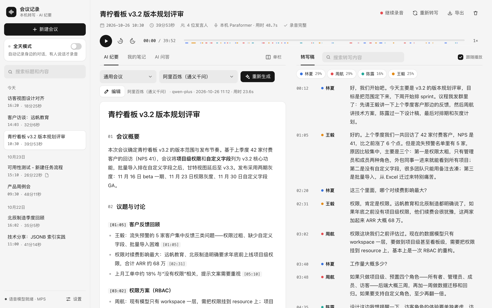
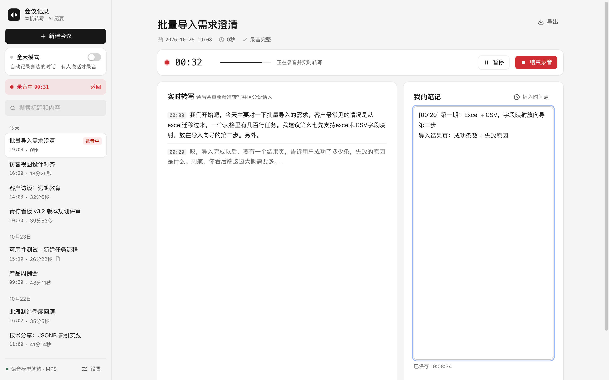
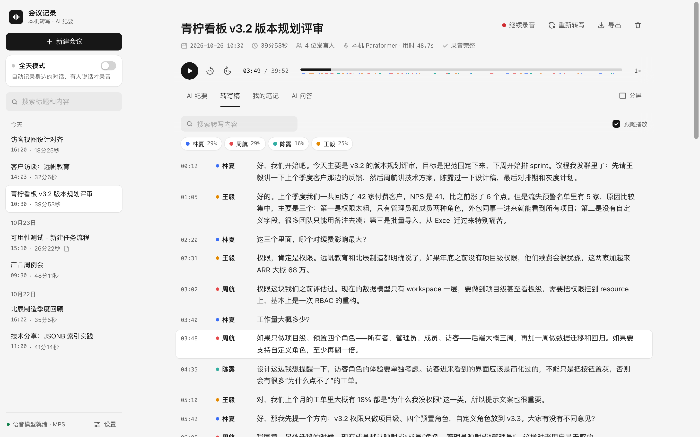
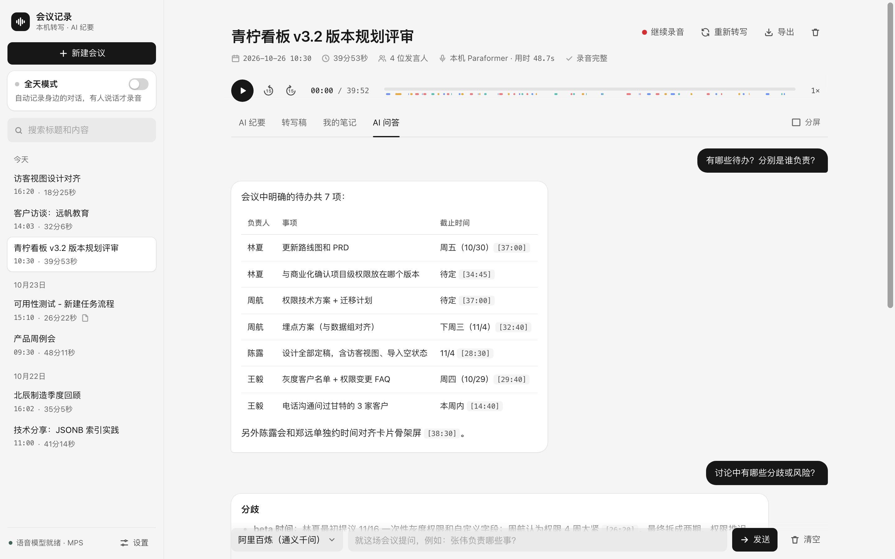
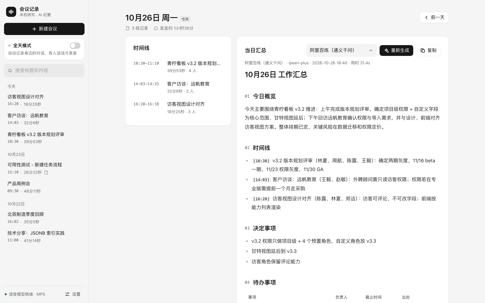
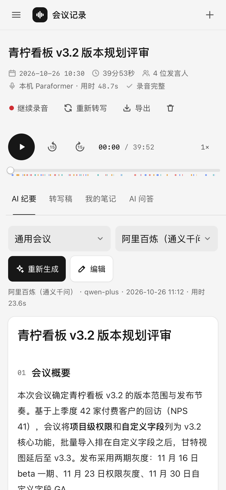
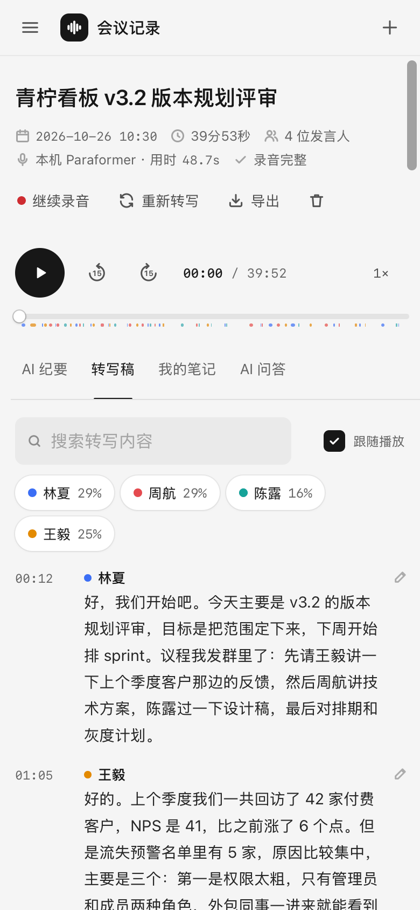
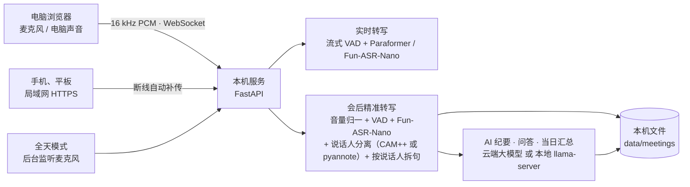
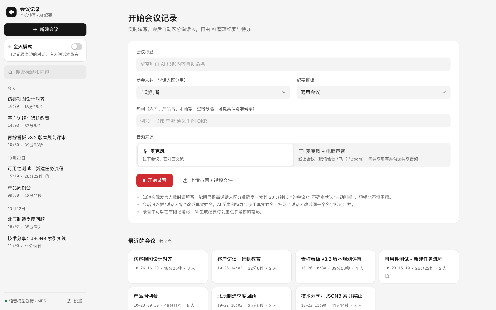

<div align="center">

# meeting-notes

**录音不出本机的 AI 会议记录**

实时转写 · 说话人区分 · AI 纪要 · 会议问答 · 全天自动记录 · 手机当麦克风


</div>



## 为什么做

会议占掉团队大量时间，会后留下来的却常常只有几行零散笔记。主流 AI 会议记录产品（飞书妙记、通义听悟、Otter.ai 等）都要把录音传到云端处理，这带来三个问题：

- **不能用**：客户、财务、人事、未发布产品相关的会议，很多公司和行业（律所、咨询、投研、医疗）对上传录音有严格限制。
- **不放心**：录音一旦上传，存多久、给谁看、拿不拿去训练模型，用户控制不了。
- **离不开网络**：断网、弱网、出差路上都用不了。

meeting-notes 把整条链路搬到用户自己的电脑上。语音识别、说话人区分都在本机完成，录音不出本机。纪要可以交给云端大模型（只发文字），也可以用本地大模型，全程离线。

## 能做什么

| 功能 | 说明 |
|---|---|
| **实时转写** | 边开会边出字。可以只录麦克风，也可以同时录电脑声音（线上会议），也能上传已有的录音、视频文件 |
| **会后精准转写** | 录音结束后自动用更大的模型整段重转：分段、补标点，按说话人整理成段落 |
| **说话人区分** | 自动判断有几个人，也可以手动指定；一句话里换了人会按声纹切开；会议室远场录音可以选专门的模式；给发言人改名，全篇同步；可以让 AI 从自我介绍、点名这类原话里推测谁是谁（附原话，确认后才改名） |
| **AI 纪要** | 6 种会议模板：通用、周会、客户访谈、招聘面试、头脑风暴、讲座。输出概要、议题、决议、待办（负责人、截止时间）、各人观点、待跟进问题，每条都带可点击的时间戳出处；推理模型思考时显示进度，输出被截断会报错而不是存半截 |
| **纪要过期提醒** | 改了转写稿、发言人名或笔记之后，纪要会提示“可能已过期”，问答也不再引用旧纪要 |
| **会议问答** | 针对一场会追问细节，只依据会议内容回答，并注明时间和发言人 |
| **全天模式** | 不用开网页，后台持续监听麦克风。有人说话才录音，静音 5 分钟自动切成一段对话并精准转写；每晚 21:30 自动生成当日汇总 |
| **手机、平板当麦克风** | 局域网 HTTPS 访问。断网照录，连回来自动补传，不丢也不重；锁屏、来电造成的空白会标在转写稿里 |
| **词库** | 常用热词提高专有名词的识别率；纠错规则把固定认错的词自动改对，对已有记录立即生效；转写里读音像热词的错写会提示出来，一键加成规则 |
| **搜索与导出** | 全文搜索标题、转写、笔记和纪要；导出 Markdown、TXT、SRT 字幕 |

<table>
<tr>
<td width="50%"><br><sub>录音中：边说边出字，旁边记笔记，一键插入时间点</sub></td>
<td width="50%"><br><sub>转写稿：按说话人着色，时间戳可点，跟随播放</sub></td>
</tr>
<tr>
<td><br><sub>会议问答：回答带时间戳出处</sub></td>
<td><br><sub>当日汇总：一天的会议串成时间线，汇总决定和待办</sub></td>
</tr>
</table>

<p align="center">
&nbsp;&nbsp;&nbsp;
<br><sub>手机、平板上用同一套页面：看纪要、看转写稿，也能直接录音</sub>
</p>

<sub>截图里的会议、人名、公司都是虚构的演示数据。</sub>

## 和云端会议记录产品的区别

| | meeting-notes | 云端会议记录产品 |
|---|---|---|
| 录音存在哪 | 自己的电脑（`data/` 目录） | 服务商的服务器 |
| 语音识别、说话人区分 | 本机 | 云端 |
| AI 纪要 | 云端大模型（只发文字），或本地大模型（全程离线） | 云端 |
| 断网能不能用 | 能 | 不能 |
| 使用成本 | 识别不花钱；纪要用云端大模型时只付 token 费（按 qwen-plus 公开价估算，一小时会议几分钱） | 一般按时长额度或订阅收费 |
| 源码 | 开源（AGPL-3.0），可以自己审计 | 闭源 |

## 效果：公开数据集实测

用 [AliMeeting](https://www.openslr.org/119/)（M2MeT 挑战赛的中文会议语料）测试。取会议室桌上麦克风阵列的一路远场录音：多人围坐、频繁抢话，是公认难做的场景。全部用产品自己的转写流程、全自动（不告诉它有几个人），用 dscore、pyannote、sclite、jiwer、MeetEval 等多套独立打分器交叉核对。

**AliMeeting Test 集：20 场，10.8 小时**

| 指标 | 上一版 | 现在（默认） | 现在（“会议室远场”模式） |
|---|---|---|---|
| 两人会议的字错率（8 场） | 8.8% | 9.0% | 9.0% |
| 3 人会议的字错率（4 场） | 33.0% | **18.8%** | **18.8%** |
| 全部 20 场的字错率 | 32.1% | **29.8%** | **29.8%** |
| “谁说了什么”的错误率 cpCER | 56.1% | 49.3% | **36.0%** |
| 说话人人数判对 | 13 / 20 | 9 / 20 | **17 / 20** |
| 说话人分离错误率 DER（collar 0.25 秒，含重叠） | 27.3% | 24.5% | **16.4%** |

- 处理速度（Apple M5 Pro）：1 小时录音约 3–9 分钟转完；“会议室远场”模式的说话人分离另需约 0.06–0.09 倍录音时长。
- 两种模式只差说话人分离，识别出的文字一样。“会议室远场”在这套会议室录音上明显更好，但在一场真实的近场会议录音（笔记本放桌上）上会把说得最多的人拆成两个，所以默认不用它。

**改进都有数据支撑。** 改算法之前，先写下评测方案和判定标准，再在开发集上选方案，最后在留出集上只测一次，不回头调参数；没达标、变差的也照实写。
最近两轮（[改进记录](docs/improvements.md)）：转写前把小声的录音拉到统一音量，离麦克风远的人不再被整段漏掉；一句话里换了人就按声纹切开；加了“会议室远场”模式；
几分钟的短录音不再一律判成 1 个人（在 AISHELL-4 留出集上截 1–4 分钟的片段，人数误差从 1.11 降到 0.60；长会议不受影响）。
没做成的也写了：两种语音分离模型、裁窗口重识别、SA-ASR、目标说话人提取都没能救回抢话；6 个改人数判断的候选在开发集上都不如现状。评测脚本都在 [tests/eval](tests/eval/README.md)，可以复现。

## 工作原理



- **语音**：[FunASR](https://github.com/modelscope/FunASR) 的 Paraformer-zh、Fun-ASR-Nano、FSMN-VAD、CT-Punc、CAM++。Apple Silicon 用 GPU（MPS），有 NVIDIA 显卡用 CUDA，其他情况用 CPU。
  “会议室远场”模式另用 [pyannote](https://github.com/pyannote/pyannote-audio) community-1 做说话人分离（单独的子进程，不占实时转写的 GPU）。
- **大模型**：任何 OpenAI 兼容接口，默认阿里百炼 qwen-plus，也可以选 DeepSeek，或本地 llama-server。
- **前端**：原生 JavaScript，没有构建步骤。用 AudioWorklet 在浏览器里降采样到 16 kHz。电脑、平板、手机共用一套页面，按屏幕宽度自动换布局。

## 快速开始

**环境**

- macOS（Apple Silicon，主要开发和实测平台）、Linux、Windows 都能跑；没有 GPU 时用 CPU，转写会慢很多。各平台的细节见 [使用说明](docs/guide.md#启动)
- [uv](https://docs.astral.sh/uv/) 和 ffmpeg：macOS `brew install uv ffmpeg`；Linux `apt install ffmpeg`；Windows `winget install astral-sh.uv Gyan.FFmpeg`
- 内存：语音模型常驻约 9–10 GB（实测），建议 16 GB 以上；本地大模型另需约 38 GB，用云端纪要就不需要
- 磁盘：第一次启动会自动从 ModelScope 下载约 4 GB 语音模型

**运行**

```bash
git clone https://github.com/MrDgbot/meeting-notes.git
cd meeting-notes
./start.sh                 # macOS / Linux：自动安装依赖、下载模型，然后打开 http://127.0.0.1:8770
.\start.ps1                # Windows（PowerShell）
```

也可以用 Docker（Linux 容器，CPU）：`docker build -t meeting-notes .`，运行参数见 [使用说明](docs/guide.md#dockerlinux-容器cpu)。



AI 纪要要配一个大模型接口：在网页“设置”里填 API Key，或者用环境变量 `DASHSCOPE_API_KEY` / `DEEPSEEK_API_KEY` 提供。不配也能录音和转写。

手机、平板访问、全天模式、各项参数和测试方法，见 [使用说明](docs/guide.md)。

## 隐私：什么会离开你的电脑

| 功能 | 离开本机的数据 |
|---|---|
| 录音、实时转写、精准转写、说话人区分、全天模式 | 无 |
| AI 纪要、问答、当日汇总，用云端大模型 | 转写文字和笔记，只发给你自己配置的接口 |
| AI 纪要、问答、当日汇总，用本地大模型 | 无 |
| 手机、平板访问 | 只在局域网内传输：HTTPS 加密，要输访问口令 |
| 憨包云端识别（实验性，默认没有，要自己配置） | 录音片段 |

语音模型第一次用时从 ModelScope 下载，之后只从本地加载。pyannote 默认会发用法统计（音频时长、人数，不含音频）到它的服务器，本项目在导入前强制关掉，并有断网测试确认一次网络连接都不发起（`tests/test_diarize_offline.py`）。

局域网访问默认关闭。打开后用的是这台电脑自己签发的根证书，并带名称限制：只能给内网地址签证书，就算证书私钥泄露，也冒充不了任何公网网站。此外还防 DNS rebinding 和跨站请求，口令只存哈希，输错多次会锁定。这些都有对抗测试覆盖（`tests/test_lan_security.py`）。

## 已知短板

说清楚现在做不好的地方：

- **多人同时说话会漏字**：AliMeeting 上重叠发言约占说话时间的 20%，65% 的错字出在以重叠为主的片段里；4 人、频繁抢话的会议字错率仍在 46% 左右。
  试过把重叠的声音先分离成两路再识别（sepformer、MossFormer2 两个现成模型），在重叠片段上字错率反而从 38.7% 升到 50% 左右；
  又试了只裁重叠那一小段重识别、SA-ASR、目标说话人提取，也都不如现状，都没有采用。
- **人数判断**：默认模式下 4 人会议仍容易判少；上一轮音量归一以后，小声的 3 人会议又容易多判一个人（Test 上人数判对从 13 场降到 9 场），这一轮试的 6 个修法都没在开发集上过关。
  6–7 人的大会议室更难：AISHELL-4 留出集 20 场只判对 10 场。会议室录音选“会议室远场”模式（AliMeeting Test 17 / 20），知道人数时在新建会议时填上，最可靠。
- **平台**：主要在 macOS（Apple Silicon）上开发和实测。Linux（Ubuntu、Docker）和 Windows 用 CI 跑过测试和端到端转写；Linux 的全天模式通过 PulseAudio / PipeWire 采音已验证，
  Windows 的全天模式用 DirectShow 采音，真实麦克风还没在真机上验证。GPU 只支持 Apple Silicon（MPS）和 NVIDIA（CUDA），其他情况用 CPU，会慢很多。

## 文档

- [使用说明](docs/guide.md)：每个功能的具体行为、参数、数据存放位置、测试命令
- [手机、平板能力边界](docs/mobile-limits.md)，[真机验收步骤](docs/real-device-checklist.md)，[手机端测试证据](docs/mobile-evidence.md)
- [评测脚本](tests/eval/README.md)：AliMeeting 数据准备、转写、打分

## 许可证

Copyright (C) 2026 MrDgbot

本项目以 [GNU AGPL-3.0](LICENSE)（或更高版本）发布：可以自由使用、修改、再发布；改过的版本只要发给别人，或者部署成服务让别人通过网络使用，就必须以同样的许可证公开完整源码。
语音模型运行时从 ModelScope 下载，不在本仓库里，各自遵守其模型许可证：

- FunASR 的 Paraformer-zh、Fun-ASR-Nano、FSMN-VAD、CT-Punc、CAM++：见各模型页的许可证。
- “会议室远场”模式用的 [pyannote speaker-diarization-community-1](https://huggingface.co/pyannote/speaker-diarization-community-1)（作者 pyannoteAI，[CC-BY-4.0](https://creativecommons.org/licenses/by/4.0/)），本项目未修改模型本身，只在它的输出上用 CAM++ 声纹合并相近的说话人。
